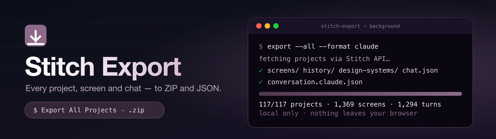
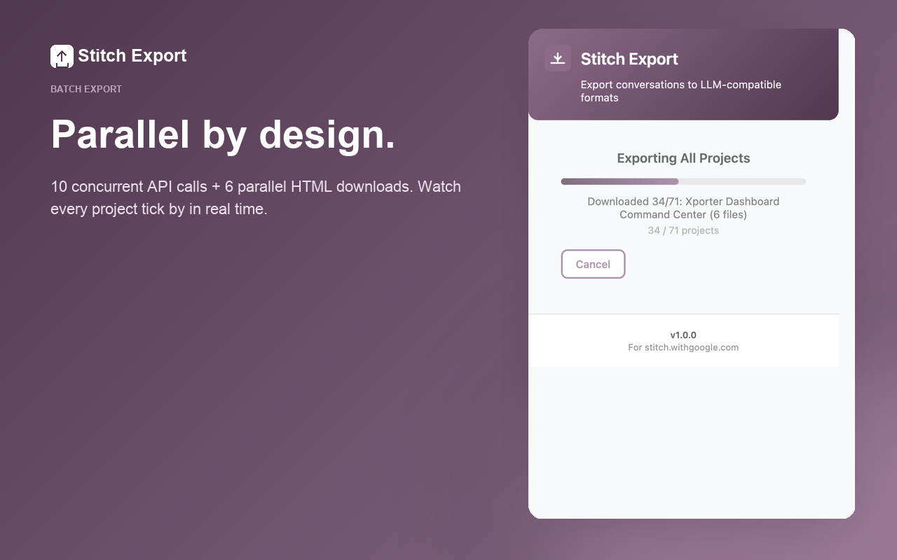
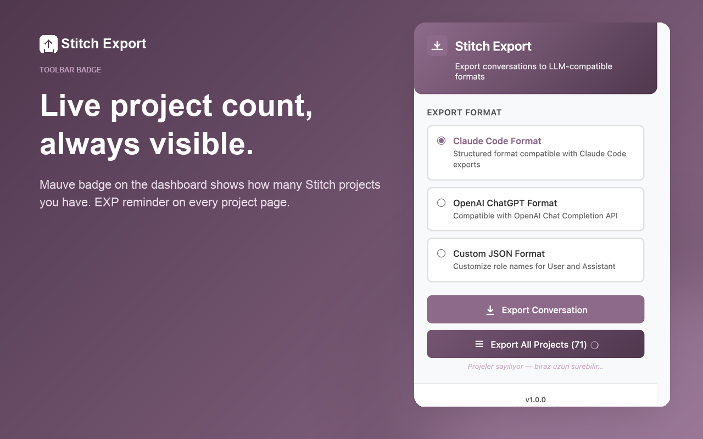

<p align="center">
  
</p>

<p align="center">
  <a href="https://chromewebstore.google.com/detail/stitch-export/epmhicnoeiapmnobjhlliadbafbkdmag"></a>
  <a href="LICENSE"></a>
  
  
  
  <a href="AGENTS.md"></a>
  
</p>

<p align="center">
  <code>google-stitch</code> <code>stitch-export</code> <code>chrome-extension</code> <code>design-export</code> <code>chat-export</code> <code>claude</code> <code>chatgpt</code> <code>llm-dataset</code> <code>ui-design</code>
</p>

**Stitch Export is a free, open-source Chrome extension for Google Stitch that exports every project — screens, images, design systems and the full chat history — to ZIP archives and LLM-ready JSON (Claude, ChatGPT), locally in your browser.**

📖 Docs: **[nsozturk.github.io/stitch-export](https://nsozturk.github.io/stitch-export/)** · 🧩 **[Install from the Chrome Web Store](https://chromewebstore.google.com/detail/stitch-export/epmhicnoeiapmnobjhlliadbafbkdmag)** · 📝 [Changelog](CHANGELOG.md)

## Features

- **Export All Projects** — every Stitch project in one ZIP: final screens, image screens at
  original resolution, per-turn screen history, design systems (`DESIGN.md`), `chat.json` and the
  conversation in your chosen format. Tested on 117 projects / 1,369 screens with nothing missing.
- **Export This Project (ZIP)** — the same for the project you have open, plus a full-size
  picture of every HTML screen.
- **Export Conversation** — the current chat as JSON only.
- **Formats** — Claude Code, OpenAI ChatGPT, or Custom (rename the user / assistant roles).
- **Runs in the background** — close the popup or switch tabs; open it again to see progress.
- **Toolbar badge** — project count on the Stitch dashboard.
- **In-page Export button and right-click menu** on project pages.
- **Local-only** — talks only to Google's own Stitch endpoints from your logged-in tab; no servers,
  no analytics.



## Installation

### Chrome Web Store (recommended)

[Install Stitch Export](https://chromewebstore.google.com/detail/stitch-export/epmhicnoeiapmnobjhlliadbafbkdmag).
Works in Chrome and Chromium browsers that install Chrome Web Store extensions (Edge, Brave).

### Developer Mode (unpacked)

1. Clone or download this repository
2. Open `chrome://extensions/` and enable **Developer Mode** (top-right)
3. Click **Load unpacked** and select the folder
4. Refresh any open Stitch tabs

## Usage

### Export every project



1. Open [stitch.withgoogle.com](https://stitch.withgoogle.com) and click the Stitch Export icon
2. Pick a format and click **Export All Projects (NN)**
3. Keep the Stitch tab that opens in the background; the popup can be closed
4. Save the ZIP when the save dialog appears

### Export one project

On a project page (`https://stitch.withgoogle.com/projects/{ID}`) click **Export This Project (ZIP)**
in the popup, or the page's **Export Chat** button → **Export ZIP (with images)**.
**Export Conversation** / **Export JSON** saves only the chat.

### ZIP layout

```
stitch-all-projects-2026-10-29/            (stitch-project-… for a single project)
└── ProjectName_<id>/
    ├── chat.json                          ← every turn, with file references
    ├── conversation.claude.json           ← chat in the chosen format
    ├── screens/
    │   ├── My_Screen_2cde0644.html        ← final screens
    │   ├── My_Screen_2cde0644.png         ← screenshot (single-project ZIP)
    │   └── Hero_image_7d381ee8.jpg        ← image-only screens, original size
    ├── history/
    │   └── turn-001-design-prompt-for-…/
    │       └── My_Screen_2cde0644.html    ← screens generated in that turn
    └── design-systems/
        └── turn-004-Warm_Editorial.md     ← DESIGN.md from design-system turns
```

### What's in `chat.json`

```json
{
  "projectId": "...",
  "projectTitle": "...",
  "exportedAt": "2026-05-15T...",
  "finalScreens": [
    {
      "name": "My Screen",
      "uid": "2cde0644...",
      "file": "screens/My_Screen_2cde0644.html",
      "screenshotUrl": "https://lh3.googleusercontent.com/..."
    }
  ],
  "turns": [
    {
      "index": 1,
      "user":      { "content": "Design a..." },
      "assistant": {
        "content": "The interface has been designed...",
        "generatedScreens": [
          { "name": "...", "uid": "...", "file": "history/turn-001-…/...html" }
        ],
        "suggestions": [
          "Design the Ghost Mode screen.",
          "Change accent to neon green.",
          "..."
        ]
      }
    }
  ]
}
```

## Export formats

### Claude Code

```json
{
  "conversation": {
    "title": "...",
    "created_at": "...",
    "messages": [
      { "role": "user", "content": "..." },
      { "role": "assistant", "content": "..." }
    ]
  }
}
```

### OpenAI ChatGPT

```json
{
  "messages": [
    { "role": "user", "content": "..." },
    { "role": "assistant", "content": "..." }
  ]
}
```

### Custom

Pick the role names yourself (e.g. `Human` / `Model`).

## Permissions

| Permission | What it's for |
|---|---|
| `activeTab` + `scripting` | Inject the export script into the current Stitch tab |
| `tabs` | Open one background tab for batch export; detect Stitch URLs for the toolbar badge |
| `contextMenus` | Right-click → Export Stitch Conversation |
| `downloads` | Save the JSON / ZIP to your Downloads folder |
| Host: `stitch.withgoogle.com`, `*.appspot.com`, `contribution.usercontent.google.com`, `lh3.googleusercontent.com` | API + design CDN access |

## Privacy

- **No external servers** — exports are local downloads only
- **No analytics, no telemetry, no tracking**
- The extension reads your existing Stitch login session via standard
  browser cookies; passwords and session tokens are never read or
  transmitted
- All network requests go to Google's own domains (Stitch API, Google
  content CDN). The extension has no servers of its own.

## FAQ

### How do I download all my Google Stitch designs at once?
Open stitch.withgoogle.com, click the Stitch Export icon and choose **Export All Projects**. You get
one ZIP with every project's screens, images, design systems and chat history.

### Can I export a Stitch chat for Claude or ChatGPT?
Yes. Pick **Claude Code**, **OpenAI ChatGPT** or **Custom** in the popup. Every ZIP contains
`conversation.<format>.json` in that format, and **Export Conversation** saves only the JSON.

### Does it include the generated images and the design system?
Yes. Image screens are saved at original resolution, HTML screens as HTML (plus a screenshot in the
single-project ZIP), and design-system turns as `DESIGN.md` files with their color tokens in `chat.json`.

### Is my data sent anywhere?
No. The extension calls Stitch's own endpoints from your logged-in tab and saves the ZIP to your
Downloads folder. There are no third-party servers, analytics or tracking.

### Can I close the popup during a long export?
Yes. The export runs in the extension's background service worker. Keep the Stitch tab it opens in
the background, and click the icon again to see progress.

### Is it an official Google product?
No. Stitch Export is an independent open-source project and is not affiliated with Google.

## Alternatives / compared with

| Approach | Screens | Images | Design systems | Chat history | All projects at once |
|---|---|---|---|---|---|
| Stitch Export | ✅ | ✅ original size | ✅ | ✅ JSON + formats | ✅ |
| Stitch's own per-screen download | ✅ one at a time | — | — | — | — |
| Copy-pasting the chat by hand | — | — | — | partial | — |

## For AI agents

[AGENTS.md](AGENTS.md) describes the code layout, Stitch RPCs and how to verify changes;
[GLOBAL_AGENT_RULE.md](GLOBAL_AGENT_RULE.md) is a snippet you can give your own assistant so it can
use and reason about Stitch Export exports. [llms.txt](llms.txt) summarises the project for LLMs.

## Development

No build step. Load the folder in Developer Mode and refresh the Stitch
page after changes.

```bash
# Syntax check
node -c background.js && node -c content.js && node -c popup/popup.js

# Regenerate doc HTML wrappers after editing any docs/stores/*/README.md
python3 docs/stores/scripts/render-docs.py

# Capture popup screenshots (requires puppeteer locally)
node screenshots/capture-puppeteer.js

# Regenerate Chrome Web Store marketing assets (requires Pillow)
python3 screenshots/gen-store-assets.py
```

## Release / publishing

See [docs/stores/ChromeWebStore/](docs/stores/ChromeWebStore/index.html)
for the full 8-phase Chrome Web Store launch guide. Quick links:

- [Master checklist](docs/stores/ChromeWebStore/README.md)
- [Package prep](docs/stores/ChromeWebStore/02-package-prep/README.md)
- [Store listing](docs/stores/ChromeWebStore/04-store-listing/README.md)
- [Privacy & permissions](docs/stores/ChromeWebStore/06-privacy-permissions/README.md)

## License

MIT — see [LICENSE](LICENSE).

## Disclaimer

Unofficial extension. Not affiliated with Google or Stitch.
